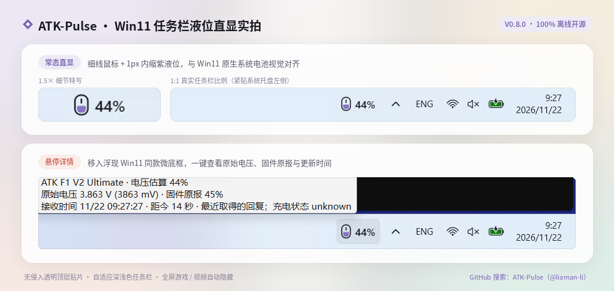
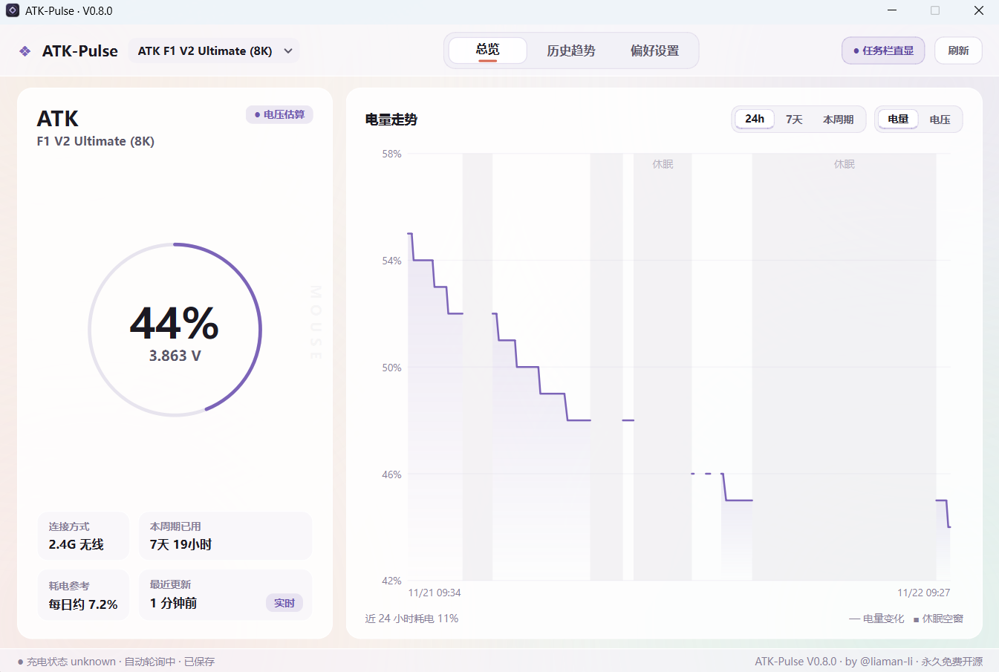
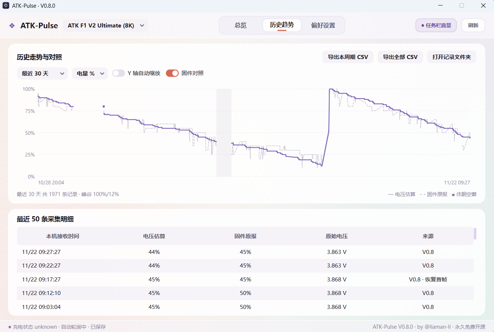
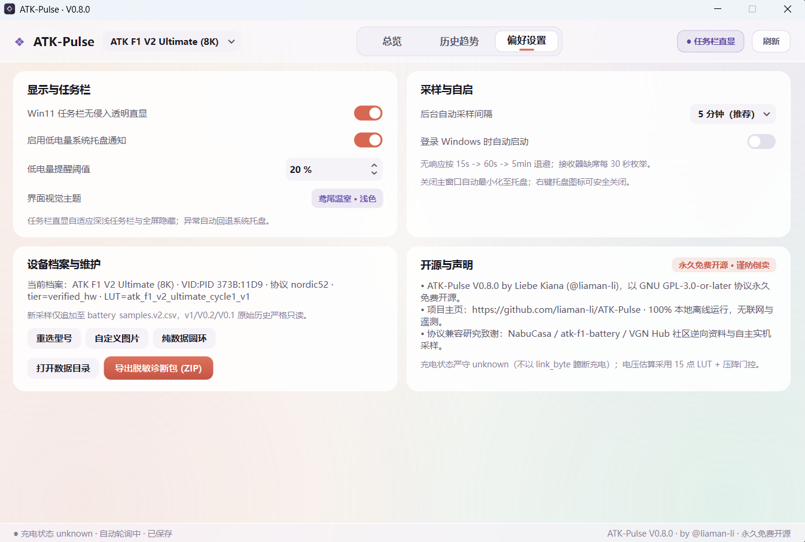

# ATK-Pulse

**ATK / VXE / VGN 离线鼠标电量与电压监测工具（V0.8.4 · 鸢尾温室 UI）**
**作者**：[Liebe Kiana (@liaman-li)](https://github.com/liaman-li/ATK-Pulse)

> **永久免费开源，谨防倒卖。**  
> 本软件遵循 `GNU GPL-3.0-or-later` 协议开源，**100% 本地离线运行**——无联网请求、无云端遥测、不收集或上传任何序列号、用户名或主机路径信息。

---

## 实机预览

**Win11 任务栏无侵入「鼠标液位填充」直显（自适应浅/深色任务栏与悬停反馈）**



| 总览（极简双栏 + 3.8px 纯数据圆环） | 历史趋势（30 天走势与 50 项明细） |
| :---: | :---: |
|  |  |
| **偏好设置（设备档案与脱敏诊断导出）** | **托盘后台驻留内存占用实测** |
|  |  |

---

## 核心特性

1. **极简双栏总览（Iris Greenhouse 浅色主题）**
   - **纯数据极细圆环**：默认采用 3.8px 极细环形电量表与电压指示，**无内置鼠标轮廓插图**；如需自定义视觉，可右键圆环（或在偏好设置中）导入本地 PNG 图片并随时恢复纯数据圆环。
   - **自然语言 2×2 指标槽**：清晰展示「连接方式」、「本周期已用」、「耗电参考（采样满 1 小时起算）」、「最近更新（刚刚 / X 分钟前 + 实时/低电/休眠状态）」。
   - **同卡唯一指标胶囊**：右上角仅展示计量口径（`● 电压估算` 或 `● 固件原报`），不重复堆叠低电红标。
2. **多周期走势、休眠间隙识别与 50 项明细**
   - 总览右侧提供 `24h / 7天 / 本周期` 与 `电量 / 电压` 快捷切换，并对超过 7.5 分钟的采集空档自动标注雾灰半透「休眠」间隙带。
   - 历史趋势页支持 `最近 1 小时 / 24 小时 / 7 天 / 30 天 / 全部记录`、虚线「固件对照」、自适应「Y 轴自动缩放」，以及安全不落盘覆盖原始 CSV 的导出功能。
3. **Win11 任务栏无侵入直显 + 托盘驻留**
   - 在系统通知区折叠箭头左侧直接显示电压估算百分比，支持深浅任务栏自适应、全屏隐藏、顶栏/托盘/偏好设置三端联动开关与异常安全降级；支持贴片右键「解锁拖动位置 / 锁定位置 / 恢复默认位置」沿任务栏自由水平拖动（自动垂直居中与边界防出界钳制），以及在「偏好设置」中进行水平偏移微调。
4. **1% 精细电压估算与全系生态只读架构**
   - **已标定机型 1% 估算**：基于 Cycle 1 实测标定的 15 点分段 LUT + 压降门控滤波 + 无线单调防抖（`ATK F1 V2 Ultimate`）；**未实机标定机型保守显示固件原报并在后台静默记录原始电压**（仅记录含真实电压字段的 `CompX` 协议，`BITMOUSE (nordic54)` 与 `EVISION Nearlink` 64B 协议无电压字段，电压保持 `None`）。
   - **全系生态扩容与安全守卫**：设备白名单已扩展至 **292 条**（覆盖 **ATK / VXE / MAD / VGN** 生态 **160+ 款**鼠标，包含 `CompX` 17B、`BITMOUSE (nordic54)` 64B 与 **EVISION Nearlink 星闪** 64B 协议族，已适配 ATK X1 星闪版无线 `373B:108C` / 有线 `373B:108B`），强制执行 Win32 `HidP_GetCaps` 17B/64B 报告长度只读守卫；`CompX` 通用接收器支持只读 `0x10`、`BITMOUSE` 无线接收器支持只读 `0x4A`（`CID,MID`）自动识别具体型号（如 `ATK Ghost Ultimate` / `ATK Z1 Ultimate 2.0` / `X1` / `A9` / `U2` / `VXE R1` / `MAD` 等）。
   - **F1 V2 Ultimate 的 100% 显示**。固件报 100%，且当前电压和滤波电压均达到 4.300 V 时，电压估算显示 100%。门限比本次充满记录中固件报满的最低电压低 13 mV，给读数波动留出余量。其余有效电压样本按放电曲线估算，最高显示 99%。
   - 严守工程诚信：`charging_state` 始终保持 `unknown`（绝不将无线连接字节臆断为充电中）；`battery_samples.v1.csv` 与早期 CSV **严格只读**，新采样写入 `battery_samples.v2.csv`。
   - 未命中设备时不再占位硬编码 F1 V2，离线诊断包新增脱敏 `hid_descriptors_sanitized.json` 以便社区补充新 PID 适配。

---

## 支持生态与验证分级（覆盖 ATK / VXE / MAD / VGN）

| 验证等级 (`verification_tier`) | 说明 | 当前状态 |
| --- | --- | --- |
| `verified` | 实机验证协议 + 已标定 15 点电压 LUT | `ATK F1 V2 Ultimate (373B:11D9)` |
| `protocol_known_uncalibrated` / `catalog_only` | 已纳入白名单并受 `HidP_GetCaps` 17B/64B 守卫保护；保守展示固件原报并记录候选电压（无电压协议记 `None`） | 292 条接收器/有线槽位，覆盖 160+ 款 `ATK / VXE / MAD / VGN` 鼠标（含 `CompX 0x10` / `BITMOUSE 0x4A` 自动识别具体型号、`BITMOUSE 64B` 与 `EVISION Nearlink` 星闪 64B，如 ATK X1 星闪版 `373B:108C` / `373B:108B`） |
| `pending_protocol` | 尚未抓取或未核实协议细节，仅识别不主动发包 | 等待社区提交抓包与诊断包的未知私有协议机型 |

---

## 快速运行（Windows 10 / 11）

### 方式 A · 普通玩家推荐（Releases 绿色免安装版）
1. 前往本仓库 [GitHub Releases](https://github.com/liaman-li/ATK-Pulse/releases) 下载对应版本的 Windows 便携包。
2. 解压至任意本地目录（勿放在受系统权限保护的目录），双击 `ATK-Pulse\ATK-Pulse.exe` 即可直接运行（无需配置 Python 环境，无黑框命令行弹窗）。
   > **提示**：本工具为个人免费开源构建、未购买商业数字签名证书，首次运行若弹出 Windows SmartScreen 蓝色拦截框，点击「**更多信息 → 仍要运行**」即可。

### 方式 B · 源码运行与本地打包
1. 确保已准备 Python 3.11 环境（项目默认使用仓库内 `.venv` 与 `PySide6 + hidapi`）。
2. 双击仓库根目录的 `启动 ATK-Pulse.cmd`，或在终端执行：

```powershell
.\.venv\Scripts\python.exe main.py
```

3. 如需自行打包 Windows 绿色正式版：

```powershell
.\.venv\Scripts\python.exe scripts\build_release.py
```

### 运行隔离自动化验收（零硬件访问）

```powershell
.\.venv\Scripts\python.exe tests\run_acceptance.py --output .\analysis_reports\v0.8_acceptance
```

---

## 离线众包与隐私脱敏导出

欢迎使用相同协议生态的玩家协助补全更多机型验证与放电标定曲线！软件内已内置**100% 离线脱敏导出**：
- **提交设备支持验证**：打开 `偏好设置 -> 设备档案与维护 -> 导出脱敏诊断包 (ZIP)`，程序会自动剔除 Windows 用户名、计算机名、盘符绝对路径与原始设备序列号（仅保留加盐单向摘要与协议采样 CSV），然后在 GitHub 提交 `.github/ISSUE_TEMPLATE/device_verification.yml` 工单并附上该 ZIP。
- **提交电池标定数据**：在 `历史趋势` 页点击 `导出本周期 CSV`，即可导出脱敏后的当前完整放电周期样本，提交至 `.github/ISSUE_TEMPLATE/lut_calibration.yml`。

---

## 开源许可与协议致谢

- **开源协议**：本项目以 [GNU General Public License v3.0 or later (GPL-3.0-or-later)](LICENSE) 发布，完整协议文本见根目录 `LICENSE`。
- **协议研究致谢**：感谢 `NabuCasa`、`atk-f1-battery` 与 `VGN Hub` 开源社区对 Nordic HID 通信特征的公开探索与参考文档；`ATK-Pulse` 底层 `protocols/` 模块全部经过净室重写并遵循 GPL-3.0 合规边界。
